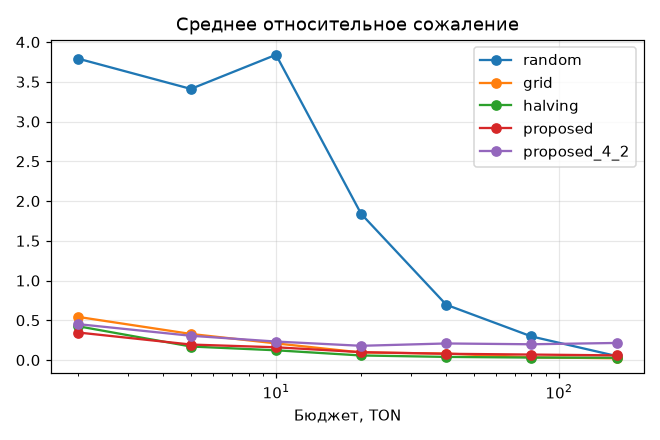
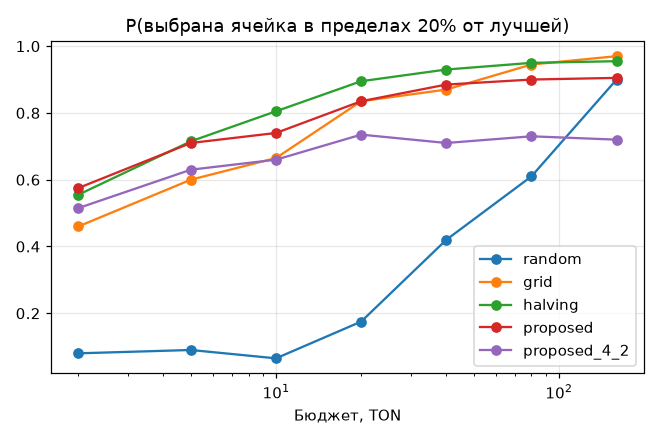

# Симулятор и бэктест политик (фаза 3)

Сгенерировано `scripts/run_sim.py` (seed=0, повторов=200, MC-сэмплов=1000, время 35 с). Числа ниже — результат прогона, ничего не подгонялось.

## Среда

- 6 гео × 4 углов креатива = 24 ячеек.
- Центры (фикстура из стартовых наблюдений раздела 4): CTR 1.25%, CVR 6.7%, CPM 0.13 TON. Порог для P(CPA<c*) в симуляции — 0.15 TON (тестовое значение).
- Разброс эффектов (σ логитов): CTR гео 0.4, угол 0.3; CVR гео 0.5, угол 0.2; взаимодействие 0.1; CPM гео lognormal σ=0.3.
- Шум: биномиальные клики и вступления. Нестационарность (матчдни, аукцион) и ограничение объёма не моделируются.

## Политики

- `random` — случайные ячейки по 8 TON (бюджет стадии 3), лучшая по наблюдаемому CPA;
- `grid` — полная сетка, бюджет поровну;
- `halving` — successive halving без модели (η=3, первый раунд по CPC, далее по CPA);
- `proposed` — модель (PosteriorModel v1 + CpmModel) + стадии: холодный старт (покрытие всех уровней), скрининг ceil(K/η)=8 ячеек по P(CPA<c*), валидация ceil(8/η)=3 лидеров; доли бюджета 30/35/35%;
- `proposed_4_2` — первый опробованный вариант той же политики: 4 ячейки на скрининге, 2 на валидации. Оставлен в отчёте, чтобы было видно, что пробовалось.

## Среднее относительное сожаление CPA(выбранной)/CPA(лучшей) − 1

| Политика | 2 TON | 5 TON | 10 TON | 20 TON | 40 TON | 80 TON | 160 TON |
|---|---|---|---|---|---|---|---|
| random | 3.791 | 3.410 | 3.840 | 1.839 | 0.695 | 0.297 | 0.050 |
| grid | 0.542 | 0.328 | 0.209 | 0.095 | 0.081 | 0.034 | 0.022 |
| halving | 0.425 | 0.170 | 0.123 | 0.057 | 0.040 | 0.031 | 0.029 |
| proposed | 0.346 | 0.195 | 0.161 | 0.099 | 0.079 | 0.069 | 0.059 |
| proposed_4_2 | 0.451 | 0.305 | 0.233 | 0.179 | 0.209 | 0.198 | 0.215 |

## P(выбранная ячейка в пределах 20% от лучшей)

| Политика | 2 TON | 5 TON | 10 TON | 20 TON | 40 TON | 80 TON | 160 TON |
|---|---|---|---|---|---|---|---|
| random | 0.08 | 0.09 | 0.07 | 0.17 | 0.42 | 0.61 | 0.90 |
| grid | 0.46 | 0.60 | 0.67 | 0.83 | 0.87 | 0.94 | 0.97 |
| halving | 0.56 | 0.71 | 0.81 | 0.90 | 0.93 | 0.95 | 0.95 |
| proposed | 0.57 | 0.71 | 0.74 | 0.83 | 0.89 | 0.90 | 0.91 |
| proposed_4_2 | 0.52 | 0.63 | 0.66 | 0.73 | 0.71 | 0.73 | 0.72 |

## P(выбрана одна из трёх лучших)

| Политика | 2 TON | 5 TON | 10 TON | 20 TON | 40 TON | 80 TON | 160 TON |
|---|---|---|---|---|---|---|---|
| random | 0.12 | 0.14 | 0.10 | 0.28 | 0.56 | 0.80 | 0.95 |
| grid | 0.57 | 0.70 | 0.78 | 0.89 | 0.89 | 0.96 | 0.97 |
| halving | 0.67 | 0.78 | 0.89 | 0.92 | 0.95 | 0.97 | 0.96 |
| proposed | 0.71 | 0.79 | 0.85 | 0.92 | 0.94 | 0.93 | 0.94 |
| proposed_4_2 | 0.66 | 0.74 | 0.77 | 0.82 | 0.82 | 0.85 | 0.83 |

## Расход до выбора ячейки в пределах 20% от лучшей

Медиана по повторам минимального бюджета из сетки, при котором выбор попал в 20%; в скобках доля повторов, где это не случилось ни при каком бюджете.

- random: 40 TON (2%)
- grid: 5 TON (0%)
- halving: 2 TON (1%)
- proposed: 2 TON (2%)
- proposed_4_2: 2 TON (9%)

## Целевой показатель: то же сожаление минимум вдвое дешевле полной сетки

| Бюджет сетки | Сожаление сетки | Бюджет `proposed` для того же сожаления | Экономия |
|---|---|---|---|
| 2 | 0.542 | 2 | 1.00× |
| 5 | 0.328 | 2.23 | 2.24× |
| 10 | 0.209 | 4.58 | 2.18× |
| 20 | 0.095 | 23 | 0.87× |
| 40 | 0.081 | 36.7 | 1.09× |
| 80 | 0.034 | ∞ | 0.00× |
| 160 | 0.022 | ∞ | 0.00× |

**Цель достигнута** при бюджетах сетки: 5, 10 TON; при остальных — нет.

## Калибровка (только `proposed`, протестированные ячейки, финальная модель)

- доля истинных CPA внутри 80%-интервала (p10–p90): 90.7% (цель ≈ 80%)
- доля истинных CTR внутри 80%-интервала (p10–p90): 77.0% (цель ≈ 80%)

## Выводы и ограничения

- Сравнение честное: у всех политик одни и те же среды (common random numbers по seed).
- Экономия считается только внутри сетки бюджетов: если `proposed` уже на минимальном бюджете лучше сетки, отношение ограничено снизу (строка «1.00×» при 2 TON означает «не меньше 1×», экстраполяции нет).
- Successive halving без модели (`halving`) на этой среде не хуже, а на средних и больших бюджетах лучше `proposed`. Модель пока окупается только на малых бюджетах, где важен перенос информации между ячейками.
- `proposed` упирается в остаточное сожаление: после холодного старта дальше идут только ячейки, выбранные аддитивной моделью, а она не видит взаимодействий гео×угол и ошибается при малых данных. На больших бюджетах сетка и halving лучше.
- Калибровка: CPA-интервалы шире номинальных 80% (консервативно, из-за temper 0.6 и широких приоров), CTR-интервалы близки к номиналу. Калибровать temper и σ после реальных данных.
Это консервативно, но снижает остроту ранжирования; калибровать temper и σ после реальных данных.
- Числа зависят от фикстуры среды (разброс эффектов). На реальной истории их надо перепроверить.





<details><summary>Сырые данные</summary>

```json
{
 "budgets": [
  2.0,
  5.0,
  10.0,
  20.0,
  40.0,
  80.0,
  160.0
 ],
 "mean_regret": {
  "random": [
   3.790605479232857,
   3.4103966053013703,
   3.8399086218384695,
   1.8388222188967591,
   0.6952372425156913,
   0.29709799039060303,
   0.050306003393807676
  ],
  "grid": [
   0.5423522788956204,
   0.32833460555696364,
   0.20945703281679587,
   0.09520985954037287,
   0.08133294532528446,
   0.03441135833951464,
   0.022327028059792517
  ],
  "halving": [
   0.4246835639853154,
   0.17016865788989288,
   0.12270113195783348,
   0.057480526031139546,
   0.03950479593303553,
   0.03102402341364304,
   0.029296173897704666
  ],
  "proposed": [
   0.3461871822564104,
   0.1950020842905092,
   0.16055776784268982,
   0.09937573769125699,
   0.07875609909371734,
   0.06910404167098547,
   0.05874658042962242
  ],
  "proposed_4_2": [
   0.45146342397666017,
   0.30533255557144645,
   0.23254060956871214,
   0.1791605432683585,
   0.20855429016456434,
   0.19838510026519057,
   0.215025280152015
  ]
 },
 "p_within20": {
  "random": [
   0.08,
   0.09,
   0.065,
   0.175,
   0.42,
   0.61,
   0.9
  ],
  "grid": [
   0.46,
   0.6,
   0.665,
   0.835,
   0.87,
   0.945,
   0.97
  ],
  "halving": [
   0.555,
   0.715,
   0.805,
   0.895,
   0.93,
   0.95,
   0.955
  ],
  "proposed": [
   0.575,
   0.71,
   0.74,
   0.835,
   0.885,
   0.9,
   0.905
  ],
  "proposed_4_2": [
   0.515,
   0.63,
   0.66,
   0.735,
   0.71,
   0.73,
   0.72
  ]
 },
 "p_top3": {
  "random": [
   0.115,
   0.14,
   0.095,
   0.28,
   0.565,
   0.795,
   0.955
  ],
  "grid": [
   0.575,
   0.7,
   0.78,
   0.885,
   0.885,
   0.96,
   0.97
  ],
  "halving": [
   0.665,
   0.78,
   0.885,
   0.915,
   0.95,
   0.97,
   0.96
  ],
  "proposed": [
   0.71,
   0.785,
   0.855,
   0.915,
   0.935,
   0.925,
   0.945
  ],
  "proposed_4_2": [
   0.66,
   0.74,
   0.77,
   0.825,
   0.825,
   0.855,
   0.83
  ]
 },
 "coverage": {
  "cpa": 0.9069163730762099,
  "ctr": 0.7698250818962853
 }
}
```
</details>
